# Avani — 3D ULPIN Generation & Vertical Property Mapping

**Smart India Hackathon 2026 · Problem Statement SIH26011**
**Live demo: <https://avani3d.vercel.app/>**

> One parcel, every dimension.

India's ULPIN (Unique Land Parcel Identification Number) identifies the *footprint* of a plot, but says
nothing about what sits above or below it: a 20-storey apartment block and an empty plot carry the same ID.
Avani extends ULPIN into the vertical dimension. It generates a unique, verifiable ID for every
flat, shop or basement unit, ties it back to the base parcel, and shows the whole building as a 3D stack.

## What it does

| Capability | How |
|---|---|
| **3D ULPIN generation** | Each unit gets `{base_ULPIN}-F{floor}-U{unit}-{check}`, e.g. `TN-07-4821-9034-7756-F3-U2-T`. Basements use negative floors (`F-1`). The last character is a check character, so a mistyped ID is caught. |
| **Vertical property mapping** | Every storey is a coloured slice; basements render below ground. Open a building in 3D, on a Cesium globe, or as an exploded floor-by-floor stack. |
| **Backward compatible** | The base ULPIN prefix is unchanged, so existing 2D land records still resolve. |
| **DIGIPIN** | Each parcel also carries its DIGIPIN (India Post grid code) from its coordinates. |
| **Volumetric validation** | Z-range per unit and overlap detection catch two units claiming the same volume. |
| **Unified Property Card (UPC)** | A shareable card per unit with a QR code and a public ID-verification page (`/verify/:code`). |
| **Three role portals** | Citizen (my units, records, complaints), Surveyor (scan, propose heights/units), Registrar (approve, resolve disputes). |
| **Real dataset** | ~6,600 OpenStreetMap building footprints for Chennai · T. Nagar, with Google Open Buildings 2.5D heights. |

NGDRS hand-off is a mock payload only; there is no real government integration.

## Try the live demo

Open <https://avani3d.vercel.app/> → **Launch demo** and sign in (credentials are pre-filled):

| Role | Username | Password |
|------|----------|----------|
| Citizen | `ramesh` | `citizen123` |
| Citizen (small holding) | `kavitha` | `kavitha123` |
| Surveyor | `priya` | `survey123` |
| Registrar | `arun` | `register123` |

Suggested walkthrough: **Citizen → Records → Capitale Tower → View Building 3D**, then **City map** to
see storey slices over satellite imagery, then **Check an ID** on the Records page.

The hosted demo is frontend-only: a small in-browser stand-in for the API (`src/demo/demoServer.js`)
serves a snapshot of the registry, and changes you make stay in your browser. Scans, rescans and
floor-plan extraction need the real backend.

## What makes it different — multimodal by design

No single data source can describe a building in 3D, so Avani **fuses several**, and tells you which one
each number came from.

| Modality | Source | What it contributes |
|---|---|---|
| **Footprints** | OpenStreetMap / Overpass (6,626 buildings in T. Nagar) | The 2D base parcel the ULPIN hangs on |
| **Heights (2.5D)** | Google Open Buildings 2.5D via Earth Engine | Measured height per footprint, so storeys aren't guesses |
| **LiDAR point clouds** | `.laz` → reprojected with `pyproj`, per-footprint ground/roof percentiles (`lidar_buildings.py`) | Surveyed height and storey count; 1.37 M-point cloud viewer in the browser |
| **Floor-plan images** | YOLO segmentation (`segmentation.py`) | Unit outlines on each floor, normalised to the floor plate; clearly labelled *estimated* when no model/plan is available |
| **Satellite & oblique imagery** | Esri World Imagery, CesiumJS globe, oblique images with ground-control points | Real-world context: see the actual roof under the extruded model |
| **Open 3D tiles** | Overture Maps buildings (PMTiles) | City-scale 3D context around the registry |

**Fusion, not just overlay.** `conflate.py` aligns a new survey to the registry (every nearby centroid pair
votes for a translation; the winning shift is removed; footprints are then matched one-to-one by IoU).
Matched buildings keep their `building_id`, so **base ULPIN, units and owners survive a re-survey**.

More things that are specific to this project:

- **Evidence you can see.** Heights carry a source badge (*Google Open Buildings 2.5D*, *LiDAR*, *surveyor-verified*,
  *registrar-approved*, *estimated from building type*). Measured values are never silently replaced by estimates.
- **Check-character IDs.** The last character of every unit ID is a check digit; the public `/verify/:code` page
  tells a genuine ID from a mistyped or forged one, and shows only a masked holder name.
- **Human-in-the-loop.** Surveyors propose heights and units with a reason and evidence; the registrar approves or
  rejects with a reason the surveyor sees. Disputed areas are marked directly on the 3D model.
- **Bilingual Unified Property Card.** Government-style UPC in English and Hindi with QR code, for a single flat.
- **Backend-free demo.** The whole registry runs in the browser from a data snapshot, no server needed.

## Screenshots

### Real buildings, real imagery

| | |
|---|---|
| 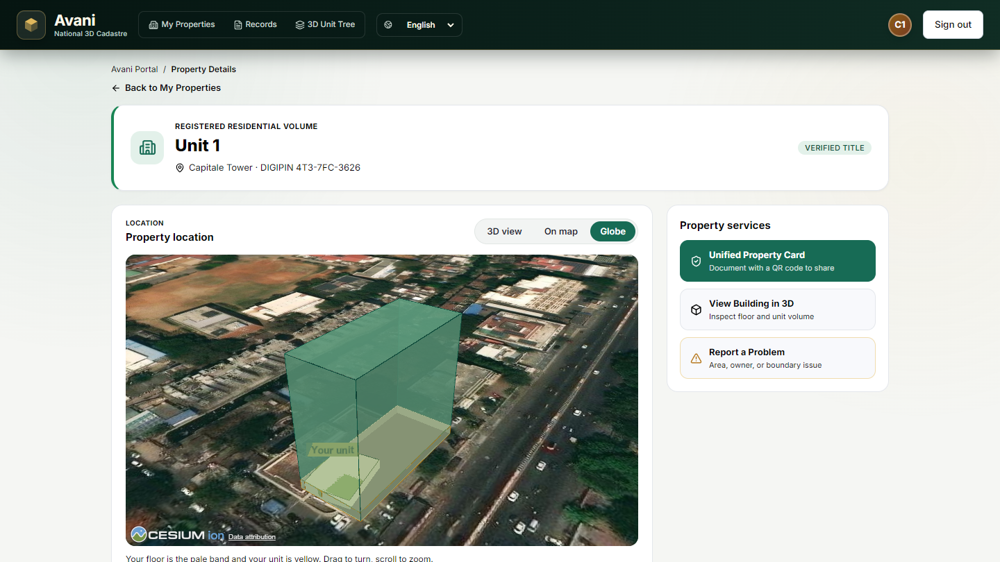<br>**CesiumJS globe** — the building's footprint extruded to its measured height over satellite imagery; the citizen's floor is the pale band, their unit is yellow | 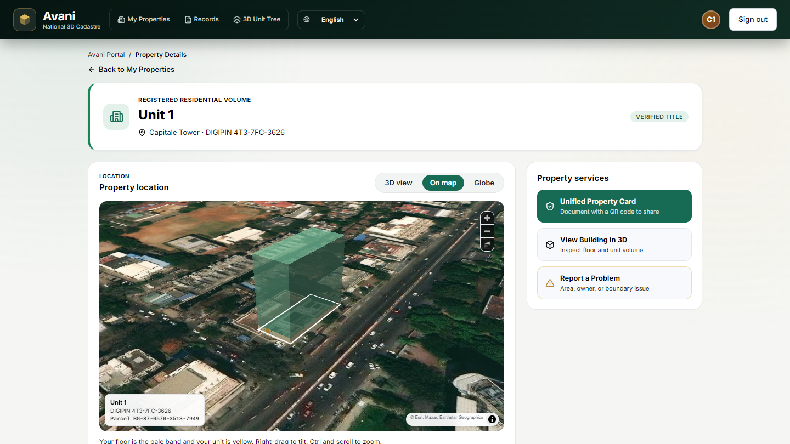<br>**Map view** — same parcel, tilted MapLibre view with the unit outlined and its ULPIN and DIGIPIN shown |
| 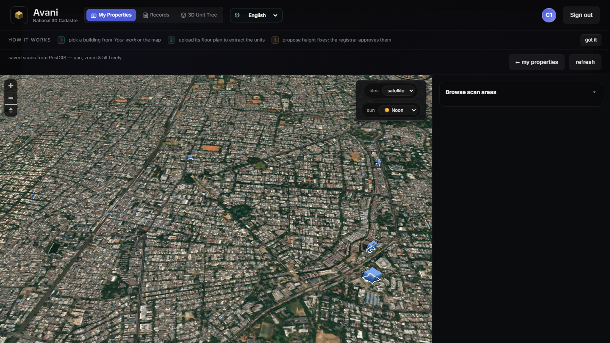<br>**City map** — T. Nagar, tilted satellite view with registered buildings | 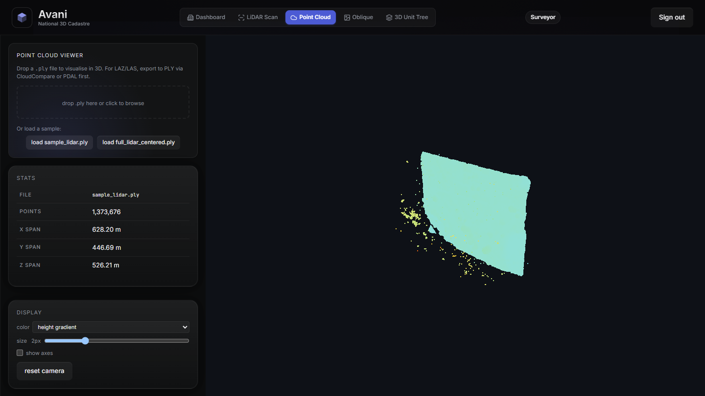<br>**LiDAR** — 1.37 M-point cloud viewer, coloured by height |

### Vertical mapping and unit IDs

| | |
|---|---|
| 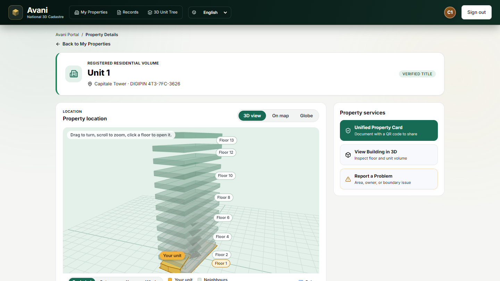<br>**Your unit in the stack** — floors labelled, the unit highlighted on its storey | 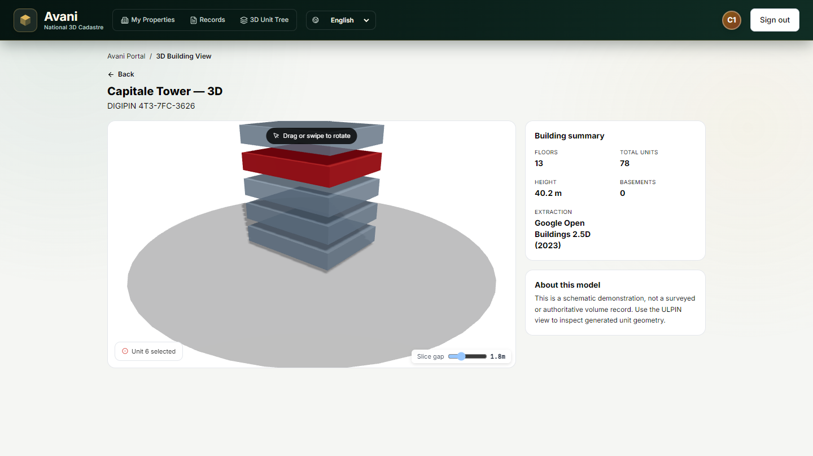<br>**Exploded view** — one slice per storey, adjustable gap |
| 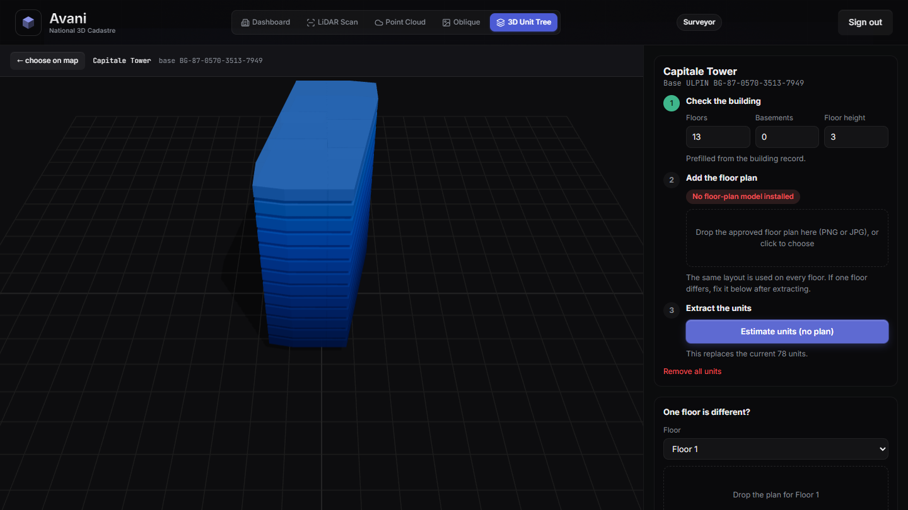<br>**Surveyor's unit editor** — building volume with floor-plan extraction and per-floor overrides | 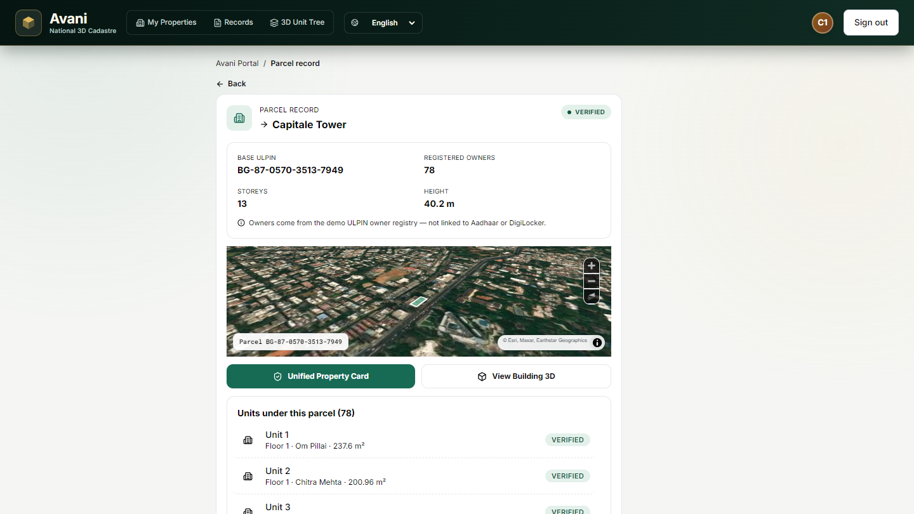<br>**Parcel record** — units per floor with satellite footprint |
| 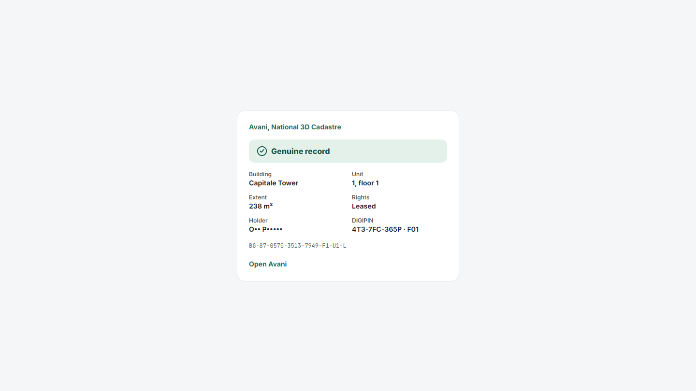<br>**Public ID check** — genuine record, masked holder | 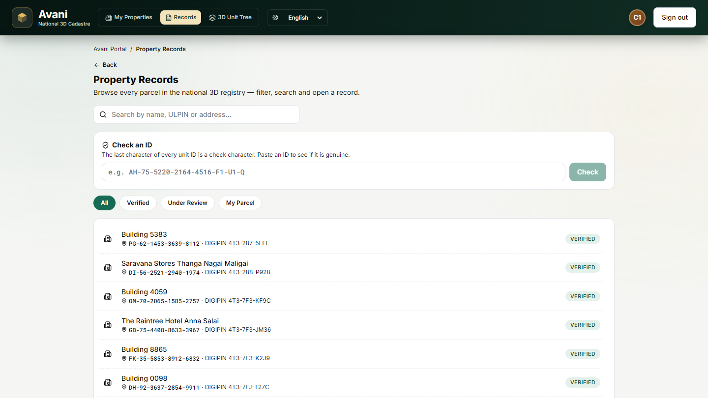<br>**Registry** — ULPIN, DIGIPIN, ID check |

### Portals

| | |
|---|---|
| 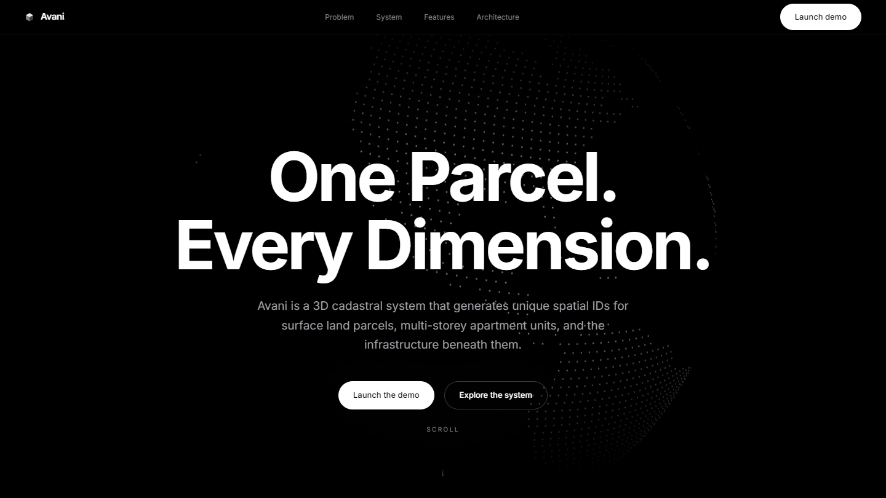<br>**Landing** | 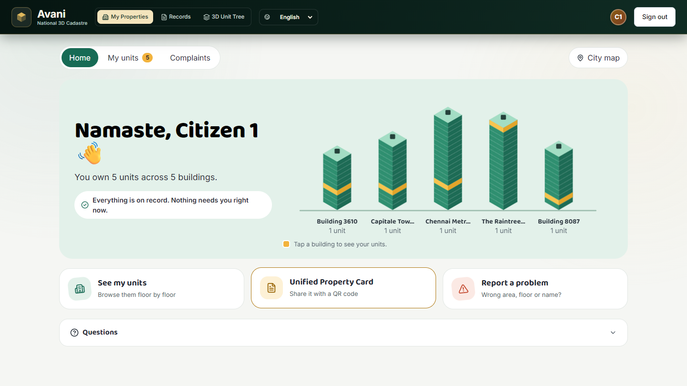<br>**Citizen dashboard** — units stacked by building |

## Architecture

```
3d_map/
├── frontend/   React 18 + Vite, MapLibre GL (city view), Three.js / react-three-fiber (unit & building 3D),
│               CesiumJS (globe, loaded from CDN on demand)
├── backend/    FastAPI + PostgreSQL/PostGIS (JSON-file fallback); ULPIN + check-char generation (app/ulpin.py),
│               DIGIPIN, LiDAR footprint conflation, YOLO floor-plan unit extraction
└── yolo-v11-wt/  stock checkpoint (not a unit model — drop your trained weights in 3d_map/models/units.pt)
scripts/        Chennai dataset converter, vertical-geometry tests
```

Full requirements and data model: [`3D_ULPIN_PRD.md`](3D_ULPIN_PRD.md) · user stories: [`userstories.md`](userstories.md) ·
status and design notes: [`PROJECT_SUMMARY.md`](PROJECT_SUMMARY.md).

## Run locally

**Frontend only (no backend, same as the hosted demo)**

```bash
cd 3d_map/frontend
npm install
npm run build:demo && npm run preview     # http://localhost:4173
```

**Full stack** — see [`run.md`](run.md) for PostgreSQL/PostGIS setup:

```bash
cd 3d_map/backend && pip install -r requirements.txt
python seed_chennai.py && uvicorn app.main:app --port 8000
cd ../frontend && npm run dev             # http://localhost:5173, /api proxied to :8000
```

## Tests

```bash
cd 3d_map/frontend && npm test            # vertical geometry & overlap logic
cd 3d_map/backend && python test_check_char.py && python test_conflate.py
```

## Deploy

- **Vercel (demo):** import the repo, set **Root Directory** to `3d_map/frontend`. `vercel.json` already runs
  `npm run build:demo` and serves `dist`.
- **Render (full stack):** `render.yaml` + `Dockerfile`; set `DATABASE_URL` (e.g. Neon) in the dashboard.

## Known limits

- Floor heights and unit layouts are *estimated* unless a floor-plan model or LiDAR scan is supplied; the UI labels them as such.
- Owner data comes from a deterministic demo registry, not a real land-records system.
- Auth is demo-grade.
